# Modèle de données de Mawjoud

PostgreSQL 16, SQL pur. Fichiers : `database/migrations/001` à `023`, appliqués à la base `mawjoud` le 13 novembre 2026 ; CSV importés le même jour. Schéma généré : `database/schema.sql`.

## Choix de conception

| Sujet | Choix | Raison |
|---|---|---|
| Pharmacies en attente | Une seule table `annuaire.pharmacie`, avec `statut_publication` | Validé. La clé ne change jamais entre l'attente et la publication. |
| Clés | `id bigint` interne pour les jointures, `uuid` pour l'API et les URL ; `id_source` garde C00001… | Validé. L'`id` numérique ne sort jamais des vues publiques. |
| Horaires | Table `annuaire.horaire` (jour 0 = dimanche, comme le front-end), texte d'origine gardé | Validé. |
| Pharmacies par compte | Table `prive.rattachement_pharmacien`, un index unique en limite à une | Validé. Retirer l'index suffira pour en autoriser plusieurs. |
| Favori | Pas de table | Validé : absent de la spécification et du front-end. |
| Signalement | Erreur sur une fiche seulement, jamais sur un stock | Validé : respecte l'idée écartée 13.3. |
| Noms de personnes (47 pharmacies) | Colonne `nom_a_verifier`, statut `a_relire` ; exclues de la publication tant que le nom n'est pas relu | Validé. Liste dans `../data/travail/NOMS_A_VERIFIER.csv`, hors du dépôt (noms de personnes : jamais dans Git). |
| Pharmacie publique et position confirmée | **Contrainte CHECK** `pharmacie_publique_complete` | La règle porte sur une seule ligne : une CHECK est déclarative, vérifiée à chaque écriture, impossible à contourner et visible dans le schéma. Un déclencheur ne sert que pour les règles qui lisent d'autres tables. |
| Position jamais écrasée en silence | **Déclencheur** `tracer_position` | Copie chaque position dans l'historique ; refuse de changer une position existante sans motif. |
| R3 et R9 (seul le pharmacien vérifié de cette pharmacie déclare) | **Déclencheur** `verifier_declarant` | Règle sur plusieurs tables, appliquée par la base même si le back-end se trompe. |
| Données personnelles | Schéma `prive` ; le public ne lit que les vues du schéma `publique` | Rôle `mawjoud_lecture_publique` sans aucun droit sur `annuaire` ni `prive`. |
| Valeurs des statuts | **snake_case partout** (`quantite_limitee`, `osm_telephone`) | Validé. La correspondance avec les valeurs à tirets du front-end se fait côté API (voir plus bas). |
| Position | `double precision` + index GiST sur `point(longitude, latitude)` | Recherche par zone de la carte sans PostGIS. |
| Recherche | `public.normaliser()` = `unaccent` + minuscules ; index `pg_trgm` | Recherche sans accent, sans casse et tolérante aux fautes. |
| Historiques et journal | Ajout seul ; modification et suppression refusées par déclencheur | Le compte qui agit est gardé sans clé étrangère, pour que le journal survive à une suppression de compte. |

**Extensions** : `unaccent`, `pg_trgm`, `citext` et `pgcrypto` sont présentes dans `C:\Program Files\PostgreSQL\16` (fichiers `.control` et `.dll`). Seules `unaccent` et `pg_trgm` sont installées, dans la base `mawjoud` (migration 002). Le schéma n'utilise que `unaccent` et `pg_trgm`, toutes deux « trusted » : le propriétaire de la base peut les créer. `gen_random_uuid()` est natif, sans `pgcrypto`.

## Diagramme entité-association

```mermaid
erDiagram
  GOUVERNORAT ||--o{ PHARMACIE : "situe"
  GOUVERNORAT ||--o{ ALERTE : "limite"
  PHARMACIE ||--o| PHARMACIE_INTERNE : "trace"
  PHARMACIE ||--o{ HORAIRE : "ouvre"
  PHARMACIE ||--o{ HISTORIQUE_POSITION : "garde"
  PHARMACIE ||--o{ DEMANDE_POSITION : "recoit"
  PHARMACIE ||--o{ RATTACHEMENT_PHARMACIEN : "est reclamee"
  PHARMACIE ||--o{ STOCK : "declare"
  PHARMACIE ||--o{ HISTORIQUE_STOCK : "a declare"
  PHARMACIE ||--o{ SIGNALEMENT : "concerne"
  PHARMACIE ||--o{ MESSAGE_CONTACT : "concerne"
  PHARMACIE |o--o{ PHARMACIE : "fusionnee dans"
  MEDICAMENT ||--o{ STOCK : "suivi"
  MEDICAMENT ||--o{ HISTORIQUE_STOCK : "historise"
  MEDICAMENT ||--o{ ALERTE : "attendu"
  UTILISATEUR ||--o{ SESSION : "ouvre"
  UTILISATEUR ||--o{ JETON : "recoit"
  UTILISATEUR ||--o{ RATTACHEMENT_PHARMACIEN : "demande"
  UTILISATEUR ||--o{ DEMANDE_POSITION : "propose"
  UTILISATEUR ||--o{ STOCK : "declare"
  UTILISATEUR ||--o{ ALERTE : "cree"
  UTILISATEUR ||--o{ ENVOI_EMAIL : "destinataire"
  UTILISATEUR ||--o{ SIGNALEMENT : "ecrit"
  ALERTE ||--o| ENVOI_EMAIL : "un seul e-mail"
  DEMANDE_POSITION ||--o{ HISTORIQUE_POSITION : "appliquee"

  GOUVERNORAT {
    smallint code PK
    text nom
  }
  PHARMACIE {
    bigint id PK
    uuid uuid UK
    text id_source UK
    text nom
    smallint gouvernorat_code FK
    float8 latitude
    float8 longitude
    boolean position_confirmee
    text statut_publication
    bigint fusionnee_dans FK
  }
  PHARMACIE_INTERNE {
    bigint pharmacie_id PK, FK
    text pharmacien_nom
  }
  HORAIRE {
    bigint id PK
    bigint pharmacie_id FK
    smallint jour
    time ouverture
    time fermeture
  }
  HISTORIQUE_POSITION {
    bigint id PK
    bigint pharmacie_id FK
    bigint demande_position_id FK
    text motif
  }
  DEMANDE_POSITION {
    bigint id PK
    bigint pharmacie_id FK
    bigint demandeur_id FK
    text statut
  }
  UTILISATEUR {
    bigint id PK
    uuid uuid UK
    text email UK
    text role
  }
  SESSION {
    bytea id_hache PK
    bigint utilisateur_id FK
  }
  JETON {
    bigint id PK
    bigint utilisateur_id FK
    text type
  }
  RATTACHEMENT_PHARMACIEN {
    bigint id PK
    bigint utilisateur_id FK
    bigint pharmacie_id FK
    text statut
  }
  MEDICAMENT {
    bigint id PK
    uuid uuid UK
    text nom_commercial
    text dci
  }
  STOCK {
    bigint pharmacie_id PK, FK
    bigint medicament_id PK, FK
    text statut
    timestamptz declare_le
    bigint declare_par FK
  }
  HISTORIQUE_STOCK {
    bigint id PK
    bigint pharmacie_id FK
    bigint medicament_id FK
    text statut
  }
  ALERTE {
    bigint id PK
    bigint utilisateur_id FK
    bigint medicament_id FK
    smallint gouvernorat_code FK
    text statut
  }
  ENVOI_EMAIL {
    bigint id PK
    bigint alerte_id FK
    text statut
  }
  SIGNALEMENT {
    bigint id PK
    bigint pharmacie_id FK
    bigint auteur_id FK
  }
  MESSAGE_CONTACT {
    bigint id PK
    text email
    bigint pharmacie_id FK
  }
  JOURNAL_AUDIT {
    bigint id PK
    bigint acteur_id
    text action
  }
  SCHEMA_MIGRATIONS {
    text version PK
  }
```

## Dictionnaire des tables

Notation : **N** = peut être vide. `now()` = date de l'écriture. Toutes les dates sont en `timestamptz`.

### `public.schema_migrations` : registre des migrations

| Colonne | Type | N | Défaut | Contrainte |
|---|---|---|---|---|
| version | text | | | Clé primaire ; trois chiffres |
| nom | text | | | Unique |
| applique_le | timestamptz | | now() | |

### `annuaire.gouvernorat` : les 24 gouvernorats

| Colonne | Type | N | Défaut | Contrainte |
|---|---|---|---|---|
| code | smallint | | | Clé primaire ; entre 11 et 83. Identiques aux CSV et à la liste INS de l'équipe ; **à confirmer avec une source officielle** |
| nom | text | | | Unique, non vide |

### `annuaire.pharmacie` : annuaire complet, publié ou en attente

| Colonne | Type | N | Défaut | Contrainte |
|---|---|---|---|---|
| id | bigint | | identité | Clé primaire interne |
| uuid | uuid | | gen_random_uuid() | Unique ; seul identifiant exposé |
| id_source | text | N | | Unique ; `C` + 5 chiffres |
| nom | text | N | | Non vide (683 lignes non publiables n'en ont pas) |
| rue, quartier | text | N | | |
| ville | text | N | | Non vide |
| code_postal | text | N | | 4 chiffres |
| gouvernorat_code | smallint | N | | → `gouvernorat.code` |
| telephone_principal | text | N | | `+216` + 8 chiffres |
| telephones_autres | text[] | | `{}` | Chaque numéro : `+216` + 8 chiffres |
| latitude | double precision | N | | Entre 30 et 38 |
| longitude | double precision | N | | Entre 7 et 12 |
| position_confirmee | boolean | | false | Vrai seulement si une position existe |
| source_gps | text | N | | tunidoc, osm_telephone, osm_nom_ville, saisie_pharmacien, saisie_admin ; obligatoire si position |
| precision_gps | text | | inconnu | exact, nom, inconnu |
| garde | text | N | | jour, nuit |
| horaires_texte | text | N | | Texte d'origine du CSV |
| statut_publication | text | | en_attente_position | en_attente_position, a_relire, pret_a_publier, publiee, non_publiable, fermee, fusionnee |
| fusionnee_dans | bigint | N | | → `pharmacie.id` ; rempli si et seulement si fusionnée |
| a_verifier | boolean | | false | |
| nom_a_verifier | boolean | | false | Nom qui est un nom de personne ; interdit la publication tant qu'il est vrai |
| sources | text[] | | `{}` | Dans la liste des sources connues |
| created_at, updated_at | timestamptz | | now() | `updated_at` mis à jour par déclencheur |

Contraintes de ligne : latitude et longitude ensemble ; source obligatoire si position ; **prête à publier ou publiée ⇒ position confirmée, nom relu (`nom_a_verifier` faux), ville et gouvernorat**.

`pret_a_publier` (migration 022) : fiche complète qui attend l'autorisation de publication des sources. Elle n'apparaît pas sur le site (les vues publiques ne lisent que `publiee`) ; la publication se fera d'un seul `UPDATE` quand les autorisations seront obtenues.

| Index | Raison |
|---|---|
| GiST `point(longitude, latitude)`, publiées | Pharmacies dans le cadre de la carte |
| `gouvernorat_code` | Filtre par gouvernorat ; clé étrangère |
| `normaliser(ville)` | Filtre par ville sans accent ni casse |
| GIN trigrammes `normaliser(nom)` | Recherche par nom tolérante aux fautes |
| `telephone_principal` | Repérer les numéros partagés |
| `statut_publication` | Listes de l'administration |
| `fusionnee_dans` | Clé étrangère |

### `prive.pharmacie_interne` : traçabilité, jamais publique

| Colonne | Type | N | Défaut | Contrainte |
|---|---|---|---|---|
| pharmacie_id | bigint | | | Clé primaire, → `pharmacie.id` |
| nom_est_nom_de_personne | boolean | | false | |
| pharmacien_nom | text | N | | Donnée personnelle |
| ids_sources | text[] | | `{}` | |
| osm_id | text | N | | `n`, `w`, `r` ou `a` + chiffres ; `a` = surface, tel que dans l'export OSM (migration 023, 3 fiches) |
| motifs_a_verifier | text[] | | `{}` | |
| motif_non_publiable | text | N | | |
| origine_nom, origine_adresse, origine_telephone, origine_gps, origine_garde, origine_horaires | text | N | | Source retenue pour chaque champ |
| created_at, updated_at | timestamptz | | now() | |

Index : la clé primaire suffit (une ligne par pharmacie).

### `annuaire.horaire` : plages d'ouverture

| Colonne | Type | N | Défaut | Contrainte |
|---|---|---|---|---|
| id | bigint | | identité | Clé primaire |
| pharmacie_id | bigint | | | → `pharmacie.id`, suppression en cascade |
| jour | smallint | | | 0 (dimanche) à 6 |
| ouverture, fermeture | time | | | Différentes ; fermeture avant ouverture = le lendemain |

Index : unique `(pharmacie_id, jour, ouverture)`, qui évite les doublons et couvre la clé étrangère.

### `annuaire.historique_position` : toutes les positions, en ajout seul

| Colonne | Type | N | Défaut | Contrainte |
|---|---|---|---|---|
| id | bigint | | identité | Clé primaire |
| pharmacie_id | bigint | | | → `pharmacie.id` |
| ancienne_latitude, ancienne_longitude | double precision | N | | |
| ancienne_confirmee | boolean | N | | |
| nouvelle_latitude, nouvelle_longitude | double precision | N | | |
| nouvelle_confirmee | boolean | | | |
| source_gps, motif | text | N | | Motif obligatoire pour changer une position existante |
| acteur_id | bigint | N | | Compte qui agit, sans clé étrangère |
| demande_position_id | bigint | N | | → `demande_position.id` |
| created_at | timestamptz | | now() | |

Index : `(pharmacie_id, created_at DESC)` pour l'historique d'une fiche ; `demande_position_id` (clé étrangère).

### `prive.demande_position` : position proposée par un pharmacien

| Colonne | Type | N | Défaut | Contrainte |
|---|---|---|---|---|
| id, uuid | bigint, uuid | | identité, gen_random_uuid() | Clé primaire, unique |
| pharmacie_id | bigint | | | → `pharmacie.id` |
| demandeur_id | bigint | N | | → `utilisateur.id` (rôle pharmacien), mis à vide à la suppression du compte |
| latitude, longitude | double precision | | | Bornes de la Tunisie |
| commentaire | text | N | | 1 000 caractères au plus |
| statut | text | | en_attente | en_attente, validee, refusee |
| motif_refus | text | N | | Obligatoire si refusée |
| decide_par | bigint | N | | → `utilisateur.id` (rôle administrateur) |
| decide_le | timestamptz | N | | Rempli si et seulement si décidée |
| created_at, updated_at | timestamptz | | now() | |

Index : unique `pharmacie_id` pour les demandes en attente (une seule en cours) ; `pharmacie_id`, `demandeur_id` et `decide_par` (clés étrangères).

### `prive.utilisateur` : comptes

| Colonne | Type | N | Défaut | Contrainte |
|---|---|---|---|---|
| id, uuid | bigint, uuid | | identité, gen_random_uuid() | Clé primaire, unique |
| email | text | | | Format d'adresse, 254 caractères au plus |
| mot_de_passe_hache | text | | | Commence par `$argon2id$` |
| role | text | | | patient, pharmacien, administrateur |
| email_verifie_le | timestamptz | N | | |
| suspendu | boolean | | false | |
| created_at, updated_at | timestamptz | | now() | |

Index : unique `lower(email)`, une adresse par compte quelle que soit la casse.

### `prive.session` : sessions de connexion

| Colonne | Type | N | Défaut | Contrainte |
|---|---|---|---|---|
| id_hache | bytea | | | Clé primaire ; SHA-256 (32 octets) |
| utilisateur_id | bigint | | | → `utilisateur.id`, cascade |
| donnees | jsonb | | `{}` | |
| created_at, derniere_activite_le | timestamptz | | now() | |
| expire_le | timestamptz | | | Après `created_at` |

Index : `utilisateur_id` (clé étrangère, fermer les sessions d'un compte suspendu) ; `expire_le` (purge).

### `prive.jeton` : liens de vérification et de désabonnement

| Colonne | Type | N | Défaut | Contrainte |
|---|---|---|---|---|
| id | bigint | | identité | Clé primaire |
| utilisateur_id | bigint | | | → `utilisateur.id`, cascade |
| type | text | | | verification_email, desabonnement |
| jeton_hache | bytea | | | Unique ; SHA-256 |
| expire_le | timestamptz | N | | Obligatoire pour la vérification |
| utilise_le | timestamptz | N | | |
| created_at | timestamptz | | now() | |

Index : `utilisateur_id` (clé étrangère) ; unique `utilisateur_id` pour le désabonnement (un lien par compte).

### `prive.rattachement_pharmacien` : réclamation ou demande d'ajout

| Colonne | Type | N | Défaut | Contrainte |
|---|---|---|---|---|
| id, uuid | bigint, uuid | | identité, gen_random_uuid() | Clé primaire, unique |
| utilisateur_id | bigint | | | → `utilisateur.id` (rôle pharmacien), cascade |
| pharmacie_id | bigint | N | | → `pharmacie.id` ; vide pour une demande d'ajout |
| ajout_nom, ajout_adresse, ajout_ville | text | N | | Nom et ville obligatoires si demande d'ajout |
| ajout_telephone | text | N | | `+216` + 8 chiffres |
| justificatif_texte | text | N | | 2 000 caractères au plus |
| justificatif_fichier_nom, justificatif_fichier_taille | text, integer | N | | Stockage du fichier à décider |
| statut | text | | en_attente | en_attente, validee, refusee, retiree |
| conflit | boolean | | false | Pharmacie déjà réclamée |
| motif_code | text | N | | Motifs du front-end ; obligatoire si refusée ou retirée |
| motif_precision | text | N | | |
| decide_par | bigint | N | | → `utilisateur.id` (rôle administrateur) |
| decide_le | timestamptz | N | | Rempli si et seulement si décidée |
| created_at, updated_at | timestamptz | | now() | |

| Index | Raison |
|---|---|
| Unique `utilisateur_id` si validée | Une pharmacie par compte |
| Unique `pharmacie_id` si validée | Un compte vérifié par pharmacie |
| Unique `utilisateur_id` si en attente | Une demande en cours par compte |
| `(pharmacie_id, statut)` | « Inscrite ? » à chaque affichage ; clé étrangère |
| `decide_par` | Clé étrangère |
| `created_at` si en attente | File de l'administration |

### `annuaire.medicament` : catalogue

| Colonne | Type | N | Défaut | Contrainte |
|---|---|---|---|---|
| id, uuid | bigint, uuid | | identité, gen_random_uuid() | Clé primaire, unique |
| code_source | text | N | | Unique (M001…) |
| nom_commercial, dci | text | | | Non vides |
| forme, dosage, categorie, nom_ar, dci_ar | text | N | | |
| donnee_test | boolean | | false | |
| actif | boolean | | true | Retrait sans perte de l'historique |
| created_at, updated_at | timestamptz | | now() | |

Index : unique `(nom, dosage, forme)` normalisés (pas de doublon) ; GIN trigrammes sur le nom commercial et sur la DCI (recherche F2).

### `annuaire.stock` : médicaments suivis et dernier statut

| Colonne | Type | N | Défaut | Contrainte |
|---|---|---|---|---|
| pharmacie_id | bigint | | | Clé primaire avec `medicament_id` ; → `pharmacie.id` |
| medicament_id | bigint | | | → `medicament.id` |
| statut | text | N | | disponible, quantite_limitee, en_rupture ; vide = suivi sans déclaration |
| declare_le | timestamptz | N | | Rempli si et seulement si un statut existe |
| declare_par | bigint | N | | → `utilisateur.id`, mis à vide à la suppression du compte |
| suivi_depuis | timestamptz | | now() | |

Index : `(medicament_id, statut)` pour les résultats d'une recherche ; `declare_par` (clé étrangère). Déclencheur : le déclarant doit être le pharmacien vérifié, non suspendu, de cette pharmacie.

### `annuaire.historique_stock` : toutes les déclarations, en ajout seul

| Colonne | Type | N | Défaut | Contrainte |
|---|---|---|---|---|
| id | bigint | | identité | Clé primaire |
| pharmacie_id, medicament_id | bigint | | | Clés étrangères |
| statut | text | | | Les trois mots |
| declare_le | timestamptz | | | |
| declare_par | bigint | N | | Sans clé étrangère |

Index : `(pharmacie_id, medicament_id, declare_le DESC)` ; `medicament_id`.

### `prive.alerte` : alertes de disponibilité

| Colonne | Type | N | Défaut | Contrainte |
|---|---|---|---|---|
| id, uuid | bigint, uuid | | identité, gen_random_uuid() | Clé primaire, unique |
| utilisateur_id | bigint | | | → `utilisateur.id` (rôle patient), cascade |
| medicament_id | bigint | | | → `medicament.id` |
| gouvernorat_code | smallint | N | | → `gouvernorat.code` ; vide = toutes les villes |
| statut | text | | active | active, terminee |
| declenchee_le, declenchee_par_pharmacie | timestamptz, bigint | N | | Remplis ensemble ; seulement si terminée |
| created_at, updated_at | timestamptz | | now() | |

Index : unique `(utilisateur, médicament, gouvernorat)` actif, avec « toutes les villes » compté comme un lieu (pas de doublon) ; `(medicament_id, gouvernorat_code)` actif (évaluation après une déclaration) ; `utilisateur_id` (Mes alertes) ; `declenchee_par_pharmacie` (clé étrangère).

### `prive.envoi_email` : file des e-mails

| Colonne | Type | N | Défaut | Contrainte |
|---|---|---|---|---|
| id | bigint | | identité | Clé primaire |
| type | text | | | verification_email, alerte |
| utilisateur_id | bigint | | | → `utilisateur.id`, cascade |
| alerte_id, pharmacie_id | bigint | N | | Obligatoires pour une alerte |
| statut | text | | a_envoyer | a_envoyer, envoye, abandonne |
| tentatives | smallint | | 0 | ≥ 0 |
| prochaine_tentative_le | timestamptz | | now() | |
| derniere_erreur | text | N | | |
| envoye_le | timestamptz | N | | Rempli si et seulement si envoyé |
| created_at, updated_at | timestamptz | | now() | |

Index : unique `alerte_id` (R11, un seul e-mail) ; `prochaine_tentative_le` à envoyer (lecture de la file) ; `utilisateur_id` et `pharmacie_id` (clés étrangères).

### `prive.signalement` : erreur sur une fiche

| Colonne | Type | N | Défaut | Contrainte |
|---|---|---|---|---|
| id, uuid | bigint, uuid | | identité, gen_random_uuid() | Clé primaire, unique |
| pharmacie_id | bigint | | | → `pharmacie.id` |
| auteur_id | bigint | N | | → `utilisateur.id` ; facultatif |
| type | text | | | adresse, telephone, position, horaires, fermeture, autre |
| texte | text | | | 10 à 2 000 caractères |
| statut | text | | nouveau | nouveau, traite, rejete |
| traite_par, traite_le | bigint, timestamptz | N | | Administrateur ; date remplie si traité |
| created_at, updated_at | timestamptz | | now() | |

Index : `pharmacie_id`, `auteur_id`, `traite_par` (clés étrangères) ; `created_at` des nouveaux (file).

### `prive.message_contact` : formulaire Contact

| Colonne | Type | N | Défaut | Contrainte |
|---|---|---|---|---|
| id, uuid | bigint, uuid | | identité, gen_random_uuid() | Clé primaire, unique |
| nom | text | N | | 100 caractères au plus |
| email | text | | | Format d'adresse |
| sujet | text | | | question, erreur_pharmacie, pharmacien, autre |
| message | text | | | 10 à 2 000 caractères, comme le formulaire |
| pharmacie_id | bigint | N | | → `pharmacie.id` |
| statut | text | | nouveau | nouveau, traite |
| created_at, updated_at | timestamptz | | now() | |

Index : `pharmacie_id` (clé étrangère) ; `created_at` des nouveaux.

### `prive.journal_audit` : qui a fait quoi, quand

| Colonne | Type | N | Défaut | Contrainte |
|---|---|---|---|---|
| id | bigint | | identité | Clé primaire |
| acteur_id | bigint | N | | Sans clé étrangère |
| action | text | | | Actions du front-end et de position |
| cible_type, cible_id | text | | | Type d'objet connu et identifiant |
| detail | jsonb | | `{}` | |
| created_at | timestamptz | | now() | |

Index : `created_at DESC` (lecture du journal), `acteur_id`, `(cible_type, cible_id)`. Modification, suppression et vidage refusés.

### Vues `publique.*`

`publique.pharmacie` (publiées seulement, avec `etat` inscrite, reclamee ou non_inscrite), `publique.horaire`, `publique.medicament` (actifs), `publique.stock` (pharmacies publiées et inscrites seulement : R7), `publique.gouvernorat`. Elles n'exposent ni `id` numérique, ni compte, ni e-mail, ni donnée interne.

## Durées de conservation (proposées, à valider)

| Données | Durée proposée |
|---|---|
| `annuaire.historique_stock` | 12 mois |
| `prive.message_contact` | 12 mois |
| `prive.session` expirées | 30 jours après expiration |

La purge sera faite côté back-end ou par une tâche planifiée, à décider.

## Confidentialité

`journal_audit`, `historique_position` et `historique_stock` gardent l'identifiant numérique du compte qui a agi, sans clé étrangère. Après la suppression d'un compte, cet identifiant reste, sans e-mail ni autre donnée. Point noté dans `STATUT.md`, section 15 (point 9).

## Correspondance des valeurs avec le front-end (côté API)

La base utilise le snake_case ; le front-end, des tirets. L'API convertit dans les deux sens : remplacer `_` par `-` à la sortie, et `-` par `_` à l'entrée, sur ces colonnes seulement.

| Colonne | Base | Front-end |
|---|---|---|
| `stock.statut` | `quantite_limitee`, `en_rupture` | `quantite-limitee`, `en-rupture` |
| `rattachement_pharmacien.statut`, `demande_position.statut` | `en_attente` | `en-attente` |
| `rattachement_pharmacien.motif_code` | `justificatif_illisible`, `informations_incompletes`, `pharmacie_attribuee`, `pharmacie_fermee`, `compte_supprime` | mêmes mots à tirets |
| `message_contact.sujet` | `erreur_pharmacie` | `erreur-pharmacie` |
| `journal_audit.action` | `creer_fiche`, `retirer_inscription`, `supprimer_compte` | mêmes mots à tirets |
| `publique.pharmacie.etat` | `non_inscrite` | `non-inscrite` |
| `annuaire.pharmacie.statut_publication` | `en_attente_position`, `a_relire`, `non_publiable` | pas de valeur front-end : le public ne voit que les pharmacies publiées |

Les valeurs d'un seul mot (`disponible`, `validee`, `patient`…) sont identiques des deux côtés. `a_confirmer` n'existe pas en base : l'API le calcule à partir de `declare_le`.

## Fonctions de la spécification et tables

| Fonction | Tables |
|---|---|
| F1 Carte | `pharmacie`, `gouvernorat`, `rattachement_pharmacien` (inscrite) ; vue `publique.pharmacie` |
| F2 Recherche | `medicament`, `gouvernorat`, `pharmacie` |
| F3 Résultats | `stock`, `pharmacie`, `rattachement_pharmacien` ; vue `publique.stock` |
| F4 Fiche | `pharmacie`, `horaire`, `stock` |
| F5 Compte pharmacien | `utilisateur`, `session`, `jeton`, `rattachement_pharmacien`, `demande_position`, `journal_audit` |
| F6 Mise à jour du stock | `stock`, `historique_stock` |
| F7 « À confirmer » | `stock.declare_le` (calculé à la lecture, rien de stocké) |
| F8 Administration | `rattachement_pharmacien`, `pharmacie`, `pharmacie_interne`, `demande_position`, `historique_position`, `signalement`, `utilisateur.suspendu`, `journal_audit` |
| F9 Compte patient | `utilisateur`, `session`, `jeton`, `envoi_email` |
| F10 Alerte | `alerte` |
| F11 E-mail d'alerte | `alerte`, `envoi_email`, `stock` |
| F12 Désabonnement, suppression | `jeton` (désabonnement), `alerte` ; la suppression du compte efface en cascade sessions, jetons, alertes et e-mails |
| F13 Bilingue | Aucune table : textes du front-end ; `medicament.nom_ar` et `dci_ar` |
| Contact | `message_contact` |

## Correspondance des CSV

### `pharmacies_final.csv` (802) et `pharmacies_en_attente_position.csv` (3 138) → `annuaire.pharmacie`

| Colonne CSV | Colonne de la base | Traitement |
|---|---|---|
| id | id_source | Tel quel ; `id` et `uuid` sont générés |
| nom, rue, quartier, ville | nom, rue, quartier, ville | Vide → NULL |
| code_postal | code_postal | Vide → NULL |
| gouvernorat | (aucune) | Contrôlé contre `gouvernorat.nom`, non stocké |
| gouvernorat_code | gouvernorat_code | Vide → NULL (88 lignes en attente) |
| telephone_principal | telephone_principal | Vide → NULL |
| telephones_autres | telephones_autres | Découpé sur ` \| ` en tableau |
| latitude, longitude | latitude, longitude | Vide → NULL |
| (fichier) | position_confirmee | Vrai pour le fichier final ; faux en attente (74 lignes ont une position non confirmée) |
| source_gps | source_gps | Vide → NULL |
| precision_gps | precision_gps | Tel quel |
| garde_jour_nuit | garde | Vide → NULL |
| horaires | horaires_texte + `annuaire.horaire` | Texte gardé ; découpé sur ` ; `, Monday…Sunday → 1…6, 0 |
| publiable (en attente seulement) | statut_publication | Final → `pret_a_publier` (755), ou `a_relire` si le nom est un nom de personne (47) ; en attente : `true` → `en_attente_position`, `false` → `non_publiable` |
| a_verifier | a_verifier | Tel quel |
| nb_sources | (aucune) | Recalculable : nombre d'éléments de `sources` |
| sources | sources | Découpé sur ` \| ` en tableau |

### `pharmacies_interne.csv` (802) → `prive.pharmacie_interne`

| Colonne CSV | Colonne de la base | Traitement |
|---|---|---|
| id | pharmacie_id | Retrouvé par `pharmacie.id_source` |
| nom_est_nom_de_personne | nom_est_nom_de_personne, et `pharmacie.nom_a_verifier` | Tel quel ; vrai → `nom_a_verifier` vrai et statut `a_relire` (47 lignes) |
| pharmacien_interne | pharmacien_nom | Vide → NULL |
| ids_sources | ids_sources | Découpé sur ` \| ` |
| osm_id | osm_id | Vide → NULL |
| a_verifier_motifs | motifs_a_verifier | Découpé sur ` ; ` |
| motif_non_publiable | motif_non_publiable | Vide → NULL |
| origine_nom … origine_horaires | origine_nom … origine_horaires | Vide → NULL |

### `../data/medicaments_test.csv` (40) → `annuaire.medicament`

| Colonne CSV | Colonne de la base | Traitement |
|---|---|---|
| id | code_source | Tel quel |
| nom | nom_commercial | |
| dci, forme, dosage, categorie | dci, forme, dosage, categorie | |
| donnee_test | donnee_test | `oui` → vrai |

Import réalisé le 13 novembre 2026 par `database/importer-donnees.ps1` : `\copy` vers des tables temporaires, puis `INSERT … SELECT` qui fait les conversions ci-dessus. Vérifications chiffrées : `database/import/verifier_import.sql` (voir `database/README.md`).
